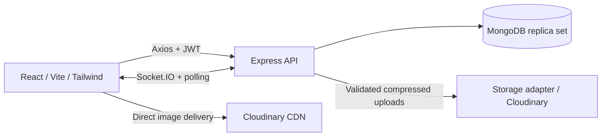
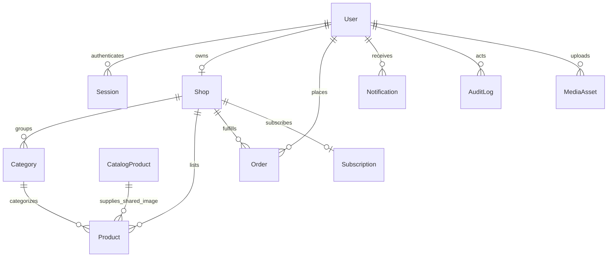

# LocalCart

**Your Neighborhood. Your Stores. Online.**

A working React/Express marketplace for independent Indian shops, backed by MongoDB. Customers browse approved stores, submit pickup or eligible delivery orders, and track progress. Shopkeepers manage their own catalog and fulfill orders; administrators control approval, delivery, users and platform settings.

The requested phases are implemented in this repository. Local automated verification is described in [the phase report](docs/PHASES.md). Live Cloudinary delivery, Atlas connectivity, external hosting and business launch configuration require your actual credentials/settings; they are not represented as verified production services.

## Run locally

Requirements: Node.js **22.12+**, npm, and either MongoDB Atlas or an installed MongoDB Community Server with replica-set support.

```powershell
npm install
npm run setup:local
```

The setup helper creates an ignored `.env` with random secrets and a local database URI. It preserves an existing `.env`. It does not create an admin account or seed fake stores.

**Using the installed local MongoDB:**

```powershell
# Terminal 1 — persistent database in .local-data/mongo, port 27018
npm run db:local

# Terminal 2 — React + Express
npm run dev
```

Visit **http://localhost:5173**. API health: http://localhost:5000/api/health. Keep using `localhost` consistently: CLIENT_URL must match the browser origin. The database helper uses its own port, data directory and replica-set name, and refuses to initialize another process's database. Stop it with Ctrl+C after stopping the app. MongoDB data persists across restarts.

**Using Atlas instead:** edit `.env` and set `MONGODB_URI` to your Atlas database URI, then run `npm run dev` without the local database helper. Create a database-scoped read/write user in Atlas, allow your development IP in Network Access, and copy the Drivers URI with `/localcart` before its query string. URL-encode special characters in database passwords. The application requires transactions and will reject standalone MongoDB at startup. No database credentials enter the frontend.

## First administrator

Set `ADMIN_NAME`, `ADMIN_EMAIL`, `ADMIN_PHONE` (10-digit Indian number) and `ADMIN_PASSWORD` (12–72 UTF-8 bytes) in the ignored root `.env`, then:

```powershell
npm run admin:create
```

Remove ADMIN_PASSWORD after creation. The script refuses to promote an existing email. Sign in through `/login` and open `/admin`. Public registration only creates customers. To become a shopkeeper, create an owner account, open `/apply`, and submit the shop application. A shopkeeper cannot approve their own store. Administrators must confirm physical verification and record notes before approval.

## Images: metadata in MongoDB, files in Cloudinary

Set these **backend-only** variables in `.env` to enable real uploads:

```dotenv
CLOUDINARY_CLOUD_NAME=
CLOUDINARY_API_KEY= 
CLOUDINARY_API_SECRET=
```

The browser compresses images before sending them; the authenticated API decodes, validates and optimizes again before a signed Cloudinary upload. Product photos are limited to one optional custom image. MongoDB contains URLs/public IDs only. Shared catalog images can be reused by many shops and overridden per listing. Fixed CDN thumbnail/detail URLs load directly from Cloudinary with lazy loading and local placeholders.

See [image architecture and safe cleanup](docs/IMAGES.md), including quotas, replacement failures and the R2 migration interface. Missing credentials produce a clear upload error while all photo-free store/product workflows continue working.

## Working features

| Customer                                                | Shopkeeper                                         | Super admin                                        |
| ------------------------------------------------------- | -------------------------------------------------- | -------------------------------------------------- |
| Register/login/restore session                          | Apply and view approval status                     | Approve, reject, suspend and reactivate stores     |
| City/neighborhood/PIN selection; optional GPS distances | Manage categories and ordering                     | Record verification notes and audit history        |
| Approved store browsing and product search              | Add/edit/archive products, stock and availability  | Manage any store's products/categories/settings    |
| Storefront/product details and share links              | Own product photo or shared catalog image          | Create reusable branded product/photo catalog      |
| Single-store persistent cart                            | Opening hours, closure, contact and prep estimates | Configure delivery fees, minimum, windows and PINs |
| Server-priced pickup/delivery checkout                  | Incoming orders with valid status actions          | Filter all orders, inspect and audit corrections   |
| Pickup code and status history                          | Verify pickup before completion                    | Record dispute resolutions                         |
| Saved addresses and repeat available items              | Sales trend, popular items, completion rate        | User suspension/reactivation and security activity |
| Notifications inbox and optional browser alerts         | Product requests, WhatsApp link and QR code        | Manual subscriptions and platform settings         |

Online payments are visibly Coming Soon. Payment is at the shop or cash on delivery. A separate delivery-partner app and paid subscription billing are not included. Delivery is manually coordinated by the operator; configured PIN codes determine eligibility. Radius is an operational setting, not a claim of verified route distance.

Preparation and delivery windows are store/admin estimates. The application never fabricates real-time stock, distances or delivery promises. Empty databases show empty states rather than mock inventory.

## Architecture



The client uses React Router, React Hook Form/Zod, TanStack Query, Axios and Lucide. Role dashboards are loaded on demand. Express validates all mutation bodies, loads current permissions from MongoDB and checks shop/order ownership. All money uses integer paise.



Mongoose schemas and indexes live in `server/models`. Order items retain name, unit, price and quantity snapshots. Pending orders reserve exact tracked inventory; rejection/cancellation releases it transactionally once. Simultaneous last-unit requests cannot both commit. Idempotency keys prevent duplicate submissions from reserving twice. Quotes perform no reservation. A changed quoted total is rejected for renewed review.

Order progression:

```text
Pending → Accepted → Preparing → Ready for Pickup → Completed
                              ↘ Out for Delivery → Completed
Pending → Rejected
Pending / Accepted / Preparing / Ready / Out for Delivery → Cancelled
```

Customers can cancel only their own pending orders. Pickup completion always requires the six-digit code. Its secure hash verifies the code; an AES-GCM encrypted copy lets only the authenticated customer retrieve it. Public APIs, owner APIs and order lists do not expose it. Administrative status changes require a reason and an audit record.

## Pages and API

Public routes: `/`, `/shops`, `/search`, `/shop/:slug`, `/cart`, `/apply`, `/about`, `/support`, `/privacy`, `/terms`, `/login`, `/register`.

Customers: `/account`, `/checkout`, `/orders`, `/orders/:id`, `/notifications`.

Shopkeepers: `/shopkeeper` with `/orders`, `/products`, `/categories`, `/requests`, `/settings`. Unapproved owners see application status and a shop-photo upload instead of management tools.

Admins: `/admin` with `/shops`, `/shops/:id`, nested store management, `/orders`, `/products`, `/users`, `/catalog`, `/subscriptions`, `/audit`, `/security`, `/settings`.

API families use `/api`:

- Authentication: `/auth/register`, `/auth/login`, `/auth/me`, `/auth/refresh`, `/auth/logout`.
- Shops: `/shops/apply`, `/shops`, `/shops/mine`, `/shops/:slug`, `PATCH /shops/:id`, `/shops/by-id/:id`.
- Catalog: shop categories/products CRUD, bulk availability, `/products/:id`, `/products/search`, `/catalog` and admin catalog CRUD.
- Orders: `/orders/quote`, `/orders`, `/orders/my`, `/orders/:id`, `/orders/:id/status`, `/orders/:id/verify-pickup`, `/shops/:id/orders`.
- Profiles and communication: `/profile`, `/notifications`, `/requests`, `/shops/:id/requests`.
- Images: authenticated `POST`/`DELETE /images/:type/:id`; multipart field `image`, one file only.
- Admin: dashboard, shops/approval/delivery, orders/dispute, products, users/status, audit, security, subscriptions and settings.

List responses use `{items,total,page,pages}` with bounded `page` and `limit` (maximum 100). A product submission cannot change its store ID; a category must belong to that same store. Category deletion is an archive and is blocked while active products reference it. Archived products retain their photo for reactivation; remove the photo explicitly to reclaim it.

## Security and sessions

Bcrypt cost 12, strict input schemas, unique email indexes, Helmet/CSP, restricted CORS/origin checks, JSON/upload size limits, NoSQL operator rejection and sanitized MongoDB queries protect the API. Tokens and credentials are not logged. Access JWTs live in memory and expire after 15 minutes. Seven-day refresh tokens travel in HTTP-only SameSite cookies, persist only as hashes and rotate atomically. Logout revokes refresh access; an existing access JWT can remain valid until expiry. Suspension denies API access immediately.

Failed-login events store keyed email/IP fingerprints for 30 days. Only administrators can review them. Store approval, suspension, delivery changes, administrative product/image changes, user status, subscriptions, settings, order corrections and dispute resolutions are audited.

This low-cost configuration runs one API instance with process-local rate limits and Socket.IO rooms, a ten-connection MongoDB pool and a bounded image-processing queue. Add shared rate-limit/socket adapters before horizontal scaling. Keep encrypted pickup keys stable and use HTTPS in production.

## Test, build and deploy

```powershell
npm test
npm run test:e2e
npm run build
npm run deploy:validate
# After Cloudinary configuration:
npm run images:verify
```

Backend tests start real isolated MongoDB instances/replica sets; they do not mock persistence or touch the development database. An installed Windows MongoDB is detected automatically. Otherwise `mongodb-memory-server` downloads a compatible binary on first run. You can set `MONGOMS_SYSTEM_BINARY` and `MONGOMS_VERSION` explicitly.

Browser tests use installed Google Chrome and isolated servers/database fixtures. Set `PLAYWRIGHT_CHANNEL=msedge` to use Edge. Test screenshots are in `artifacts`; Playwright failure traces are in ignored `client/test-results`. Browser tests cover desktop/mobile approval-to-pickup, delivery, catalog configuration, profile persistence, permissions and PWA offline fallback. See [phase verification](docs/PHASES.md) for the final observed results and remaining external checks.

`npm run build` produces `client/dist`. Deploy it on a static host with SPA fallback and the Express API on a Node host, or use the provided same-origin Render Blueprint. Read [deployment and operational constraints](docs/DEPLOYMENT.md) before deployment. Image traffic goes directly to the CDN in either arrangement.

The PWA includes an install manifest and offline information page. It deliberately does not cache APIs, orders or customer data and does not submit orders offline. Browser notifications work only where supported and while the app page handling them is open; persisted inbox updates remain the reliable fallback.

## Troubleshooting

- **API startup fails:** check `.env`, database URI, Atlas IP access and replica-set support. `npm run db:local` starts the separate local replica set. Existing standalone MongoDB on 27017 is not sufficient for transactions.
- **Untrusted request origin:** open `http://localhost:5173` and match CLIENT_URL exactly. Do not alternate `localhost` and `127.0.0.1`. Custom backend ports also require API_PROXY_TARGET when starting Vite.
- **Image upload unavailable:** set the three backend Cloudinary values, restart the API and run `npm run images:verify`. Use a supported static image below 5 MB. No local image-file persistence is used.
- **Delayed image deletion:** the API processes 20 retired assets per cleanup pass. Provider outages and sleeping hosts delay deletion. Inspect queue metadata and run `npm run images:cleanup`.
- **Refresh token fails in another tab:** concurrent refresh rotation consumes a token only once. A losing tab may need to sign in again; the same-tab client deduplicates refresh requests.
- **No stores:** the database starts empty. Apply as a shopkeeper and approve through an administrator after real verification. Select the matching city/PIN; unapproved or suspended stores are hidden.
- **Stock lower than physical shelf count:** pending tracked orders already reserve stock. Enter unreserved quantities. Reject/cancel unwanted orders to release reservations.
- **Browser tests cannot start:** make Chrome/Edge available, free ports 5109/5179, and allow a MongoDB test-binary download or configure the installed mongod path.
- **Production sessions fail:** use same-site HTTPS domains or one origin. Default URLs on unrelated hosting domains are intentionally incompatible with the current cookie policy.
- **Order updates are delayed:** check the Socket.IO proxy; pages continue polling. Browser alerts are never treated as guaranteed delivery.

Operator-specific legal text, real physical shop verification, credentials, backups/restore verification and a production load/host review remain launch responsibilities. The UI includes informational pages rather than inventing a business identity or returns policy.
